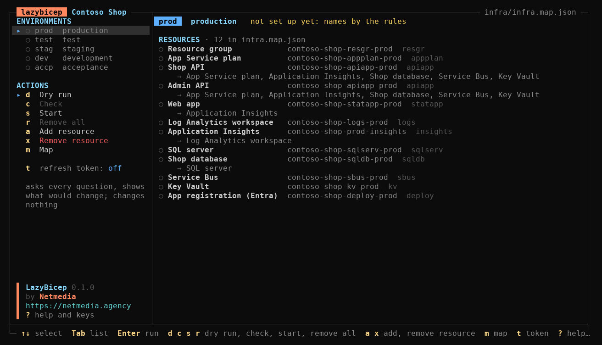
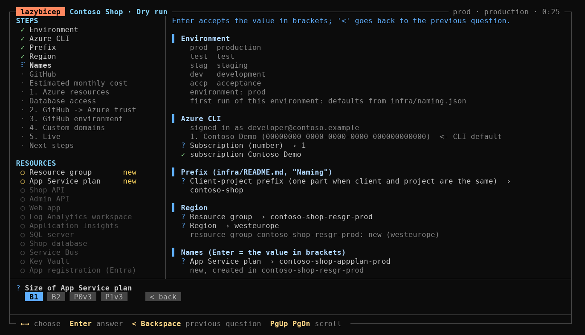
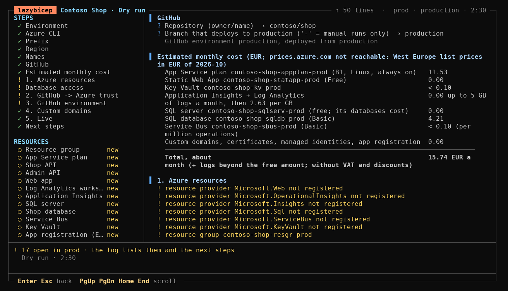
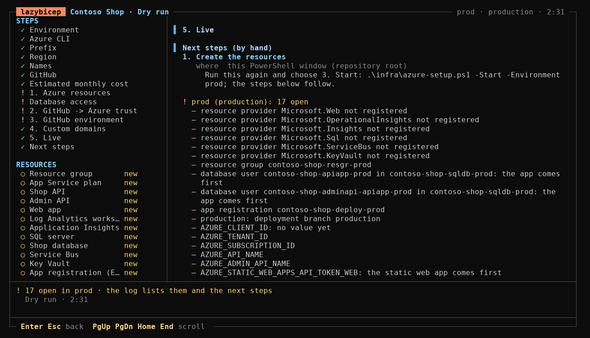

# LazyBicep — Developer Guide

How to install LazyBicep, add it to a project, and use it there. Reference for every script: `-Help` on the script, `?` in the UI, and `infra/LAZYBICEP.md`.

## Overview

LazyBicep (v0.1.0) keeps a project's whole Azure infrastructure in **one map** (`infra/infra.map.json`) and sets it up, checks it, changes it and removes it environment by environment, from a terminal UI or plain PowerShell. Use it on every Netmedia project that runs on Azure.

What you get:

- **One source of truth** — the map lists the apps, databases, queues, vaults and telemetry, and how they connect (managed-identity roles, settings, deploy roles).
- **`main.bicep` is generated** from the map and the catalog. Never edit it by hand.
- **Safe runs** — every run does a what-if first and asks before each change; a second run with the same answers changes nothing.
- **No secrets** — managed identities, Entra-only SQL, keyless Service Bus and storage, GitHub → Azure trust over OIDC.
- **Generated GitHub Actions** — deploy workflows per app and build/CI workflows, all from the map.
- **Cost estimate** — every mode shows the estimated monthly cost from Azure list prices (EUR by default).

The pieces:

| Piece | Where | What it does |
| --- | --- | --- |
| `initintoproject.exe` / `.ps1` | LazyBicep repo | Copies the kit into a project, or updates it |
| `lazybicep.exe` / `lazybicep.ps1` | Project root and `infra\` | Terminal UI over everything below |
| `azure-setup.ps1` | `infra\` | The engine: dry run, check, start, remove, add/remove resource, new project |
| `generate.ps1` | `infra\` | Builds `main.bicep` and `.github/workflows` from the map |
| `analyze.ps1` | `infra\` | Reads the solution and suggests resources |
| `import.ps1` | `infra\` | Reads existing Azure resource groups and suggests a map (read-only) |
| `route.ps1` | `infra\` | Tells a workflow which environment a branch deploys to |

Every script explains itself: run it with `-Help` (or `-h`). In the UI, `?` shows the keys of the current screen. Full reference: `infra/LAZYBICEP.md` in any project.


Everything before Start only writes files in `infra\`. Later changes go back through dry run and Start; Check shows drift without changing anything.

## Install from scratch (once per PC)

You need Windows PowerShell 5.1 or PowerShell 7, the Azure CLI, the GitHub CLI and a clone of the LazyBicep repo. No PowerShell modules.

1. Install the CLIs:

   ```powershell
   winget install Microsoft.AzureCLI GitHub.cli
   ```
2. Sign in to GitHub with an account that is **admin of the project repository** (the setup creates GitHub environments, variables and secrets):

   ```powershell
   gh auth login
   ```
3. Sign in to Azure (add `--tenant <tenant>` if the subscription is in another tenant). The Azure CLI's default subscription is the one LazyBicep uses:

   ```powershell
   az login
   az account set --subscription <name-or-id>
   ```
4. Clone the kit somewhere stable, e.g. next to your projects:

   ```powershell
   git clone https://github.com/netmedia/lazybicep D:\Development\Netmedia\LazyBicep
   ```
5. Use Windows Terminal (or the Windows 10+ console) so the UI's colours and box characters render.

Notes:

- The `.exe` files are thin launchers for the `.ps1` of the same name, so there is no execution-policy prompt and double-click works. They are not code-signed; SmartScreen may ask once on a new PC.
- In PowerShell, start them as `.\lazybicep.exe` (PowerShell never runs a program from the current folder by name alone). In cmd, `lazybicep` is enough.
- Rebuild the launchers with `.\build-exe.ps1` only when `launcher\launcher.cs` or the version changes.

## Add LazyBicep to a project

Run `initintoproject` from the LazyBicep repo, pointing at the project's `infra` folder. It copies the kit; nothing in Azure changes.

```powershell
cd D:\Development\Netmedia\LazyBicep
.\initintoproject.exe D:\Development\Netmedia\MyProject\infra -DryRun   # preview what is copied
.\initintoproject.exe D:\Development\Netmedia\MyProject\infra
```

- The folder is created if missing. If the target is not named `infra`, `infrastructure`, `iac`, `azure`, `bicep` or `deploy`, it asks: create `<Target>\infra` (Yes, default) or put the kit directly into `<Target>` (No).
- `lazybicep.exe` is also placed in the project root, so the UI starts from either place.

What ends up in the project:

| Path | Owner | Commit? |
| --- | --- | --- |
| `infra/infra.map.json` | Project (created by New project) | Yes |
| `infra/naming.json` | Project (naming patterns, prefix, abbreviations) | Yes |
| `infra/environments/<env>.json` | Project (answers per environment) | Yes — workflows read them |
| `infra/main.bicep` | Generated from the map | Yes, never edit |
| `.github/workflows/*.yml` with `# GENERATED` | Generated from the map | Yes, never edit |
| `infra/new-kinds.md` | Written by an import | Optional |
| `infra/README.md` | Project notes | Yes |
| `azure-setup.ps1`, `lazybicep.*`, `generate.ps1`, `analyze.ps1`, `import.ps1`, `route.ps1`, `catalog/`, `modules/`, `LAZYBICEP.md`, `kit.json` | Kit (replaced on update) | Yes, don't edit in the project |

Put project-specific notes in `infra/README.md`, not `LAZYBICEP.md` — a kit update replaces the latter.

### Update the kit in a project

```powershell
.\initintoproject.ps1 D:\Development\Netmedia\MyProject\infra -Update
cd D:\Development\Netmedia\MyProject
.\infra\generate.ps1                                   # does main.bicep change?
.\infra\azure-setup.ps1 -DryRun -Environment test     # what that means in Azure
```

The update replaces only the files `kit.json` lists; the map, `naming.json`, `environments/`, `README.md` and any project-only catalog kinds stay. Old LazyAzure projects lose `lazyazure.*` and `LAZYAZURE.md`, replaced by `lazybicep.*`.

## The terminal UI

Start it from the project root with `.\lazybicep.exe` (or `.\infra\lazybicep.ps1 -Environment test` to preselect an environment). The UI does no work itself: it runs `azure-setup.ps1 -Ui`, so the UI and the scripts always behave the same.

| Screen | What you see | Keys |
| --- | --- | --- |
| **New** (no map yet) | Prompt to start a project | `n` new project, `?` help, `q` quit |
| **Home** | Environments, actions, the selected environment's resources and what each connects to | ↑↓ environment, `Tab` environments ↔ actions, `Enter` run action, `d` dry run, `c` check, `s` start, `r` remove all, `a` add resource, `x` remove resource, `m` map, `t` refresh token on/off, `?` help, `q` quit |
| **Map** | Every resource in detail: naming, kind, Azure type, Bicep params, cost, app settings, secrets, connections; then domains, GitHub, live checks, steps | ↑↓ resource, `PgUp`/`PgDn` scroll, `a` add, `x` remove selected, `Esc` back |
| **Run** | Step progress, resource states, log, and the current question at the bottom | `Enter` answer (empty = default shown), ←→ choose, `Space` toggle (multi-select), `y`/`n`, `<` previous question, `PgUp`/`PgDn`/`Home`/`End` scroll log, `Esc` stop (asked first); when done `Enter`/`Esc` back |

The `t` toggle is the same as `-RefreshToken`: it re-sets the Static Web App deployment token in GitHub, e.g. after you reset it in the portal.

### Screens

The screenshots come from a demo project (the example spec, "Contoso Shop") running against a test subscription, so names, prices and open items are only examples.

**New project** — what you see in an `infra` folder that has no map yet. Press `n`.


**Home** — environments and actions on the left; the selected environment's resources, their names and what each connects to on the right.



**Map** (`m`) — one resource in detail: naming, kind, Azure type, app settings, its generated deploy workflow and its connections.


**Run: a question** — steps on the left, the log on the right, the question at the bottom. Here it's a choice, so you pick with ←→; text questions show the default, and `Enter` keeps it.



**Run: estimated monthly cost** — every dry run, check and start shows it before touching Azure.



**Run: finished dry run** — `!` marks the steps that still have open items; the log lists them along with the next steps.



## Workflows

Each scenario below gives the UI path and the equivalent script command. Nothing touches Azure until a **Start**; building the map, dry runs and checks are always safe.

### 1. Start the map of a new project

After `initintoproject`, open the UI (`.\lazybicep.exe`) and press `n`, or run `.\infra\azure-setup.ps1 -Init`. It first asks how to find the resources. All four routes then ask the project name, the name prefix (`client-project`, e.g. `contoso-shop`), the region and the deployment name, and finish by writing `infra.map.json` and `naming.json` and generating `main.bicep`.

**1a. Analyze the solution** — best for a codebase that is not yet in Azure.

```powershell
.\infra\azure-setup.ps1 -Init -Analyze       # skip the 'how' question
.\infra\analyze.ps1                         # just show what it would suggest
.\infra\analyze.ps1 -Out spec.json          # write it as an editable spec
```

It reads files only (runs nothing) and suggests: .NET Web → App Service (runtime, health check path from `MapHealthChecks`); .NET isolated Functions → Function App (Flex Consumption); Blazor WASM or React/Angular/Vue/Vite etc. → Static Web App; Node/Python servers → App Service; SQL connection strings / EF Core → SQL database per connection-string name; Service Bus queues found in code; storage and storage queues; Key Vault; Application Insights. Project references count. Each suggestion shows what it was found from (`Add Shop (ShopDb) (sqlDatabase)? [Y/n]`), then the usual questions with the findings as defaults. Workers, Redis, Cosmos DB, topics, PostgreSQL etc. are reported but not added.

**1b. Import from Azure** — for a project whose resources already exist.

```powershell
.\infra\azure-setup.ps1 -Init -Import -ResourceGroup contoso-shop-resgr-prod
.\infra\import.ps1 -ResourceGroup contoso-shop-resgr-prod -List   # preview only
```

Read-only. Pick the subscription, one or more resource groups, the resources and which environment they are. It reads runtimes, health checks, plans, SWA build folders, SQL databases, Service Bus and storage queues, Front Door origins, and each app's settings (matched by host name; values never shown or stored) and identity role assignments. Then choose:

- **connect** — the map takes over the existing resources with their real names. The first dry run asks every question once with those names as defaults; a Start then adds only what is missing (managed identities, roles, settings, security hardening, OIDC trust, GitHub environment, deploy workflows).
- **new** — the same resources are created fresh by the naming rules, keyless with managed identities. Move data and delete the old ones by hand.

Kinds the catalog lacks are listed in `infra/new-kinds.md` (see scenario 13).

**1c. By hand** — pick resources one by one from the catalog. For each it asks what it needs (a database: which SQL server, or a new one), which apps use it, and for an app what it uses.

**1d. From a spec file** — repeatable and reviewable; good for templates.

```powershell
.\infra\azure-setup.ps1 -Init -SpecFile spec.json
```

Start from `examples/spec.example.json` in the LazyBicep repo or from `analyze.ps1 -Out`. Per resource: `kind`, `key`, `title`, `answers`, `requires` (`{kind: key}` or `"new"`), `users`, `uses`, `roles`. Anything left out takes the default.

```json
{
  "project": { "name": "Contoso Shop", "prefix": "contoso-shop", "region": "westeurope", "deploymentName": "shop-{env}" },
  "resources": [
    { "kind": "appServicePlan", "key": "plan" },
    { "kind": "appService", "key": "api", "title": "Shop API", "answers": { "runtime": "DOTNETCORE|10.0" }, "requires": { "appServicePlan": "plan" } },
    { "kind": "sqlDatabase", "key": "shopDb", "requires": { "sqlServer": "new" }, "users": ["api"] }
  ]
}
```

Commit `infra\` once the map exists.

### 2. Create an environment in Azure

Environments: `prod`, `test`, `stag`, `dev`, `accp` (from `naming.json`).

1. **Dry run** — asks every question (names, sizes, SQL admin, deploy branch, domains…), shows what exists and what would be created, plus the monthly cost. Saves nothing.

   ```powershell
   .\infra\azure-setup.ps1 -DryRun -Environment test     # UI: select test, d
   ```
2. **Start** — same questions, then creates what is missing, asking before each change.

   ```powershell
   .\infra\azure-setup.ps1 -Start -Environment test      # UI: s
   ```
3. **Commit** `infra\` (map, `naming.json`, `main.bicep`, `environments\test.json`) and `.github\workflows`. The workflows read these files.

A Start runs these steps in order: save answers to `environments/<env>.json` → Azure resources (what-if, deploy only on a real change) → apps' SQL database users (by managed-identity client id; your IP is let through the firewall for the step, asked first) → GitHub → Azure OIDC trust → GitHub environment (variables, deployment tokens, deploy only from its branch) → custom domains (DNS checked, free certificates) → live checks → a list of manual next steps.


In a Run, `<` goes back to the previous question until the first change is made. Re-running with the same answers changes nothing.

### 3. Add another environment based on an existing one

Start a dry run or Start for the new environment (e.g. `test`); the first question offers to copy another environment's answers (e.g. `prod`). It translates them:

- Names: `-prod` → `-test` (or `-test` is appended).
- Domains: `dev.app.example.com` → `test.app.example.com`; `app.example.com` → `app-test.example.com`.
- Deploy branch: `production`/`prod` → `test`, `release/prod` → `release/test`; anything else becomes manual runs. A Start offers to create a missing branch from the source's.
- Shared resources stay shared. Every question is still asked; nothing is saved before the normal save.

When the answers are saved, every deploy workflow's triggers are regenerated to include the new branch. Commit them.

### 4. Check an environment for drift

```powershell
.\infra\azure-setup.ps1 -Check -Environment prod      # UI: c
```

Uses the saved answers, asks nothing, changes nothing. Reports what is in place and what is missing compared with the map. Run it after manual portal changes, before a release, or when something "stopped working". To fix what it finds, run a Start.

### 5. Remove an environment

```powershell
.\infra\azure-setup.ps1 -Remove -Environment test     # UI: r
```

Shows everything the setup created for that environment and deletes it only after you type the resource group's name. Shared resources are not removed.

### 6. Add a resource to the map

```powershell
.\infra\azure-setup.ps1 -AddResource                    # pick from the catalog
.\infra\azure-setup.ps1 -AddResource -Kind sqlDatabase   # UI: a on Home or Map
```

It asks what the resource needs (e.g. which SQL server, or a new one) and which apps use it. Each app gets its roles and settings: a database user plus a password-less connection string `ConnectionStrings__<Key>`, Service Bus Data Sender/Receiver, Key Vault Secrets User, storage data roles, and so on. Adding an app asks its source folder and writes its deploy workflow. Then it updates the map and regenerates `main.bicep`.

To put it into Azure: dry run, then Start, per environment (scenario 2). Commit the map, `main.bicep` and workflows.

Available kinds:

| Kind | Use it for |
| --- | --- |
| `appService` | API or web app on App Service Linux (.NET, Node, Python, Java, PHP; default .NET 10) |
| `staticWebApp` | Front end on Static Web Apps (Free or Standard) |
| `functionApp` | Azure Functions, Flex Consumption or on a plan (default .NET 10 isolated) |
| `appServicePlan` | Linux plan, new or shared |
| `sqlServer`, `sqlDatabase` | Azure SQL, Entra sign-in only |
| `serviceBus` | Namespace with queues, keyless |
| `storage`, `storageQueue` | StorageV2 without keys; a single queue with a per-queue role |
| `keyVault` | RBAC vault |
| `appInsights`, `logAnalytics` | Telemetry |
| `frontDoor` | Front Door Standard/Premium in front of an app (custom domain and locking the app to Front Door are manual for now) |

**Several of one kind** (two APIs, two databases) is fine: add it again with a different key; it gets its own sub-application name, e.g. `<prefix>-api2-apiapp-<env>`.

### 7. Import existing Azure resources into an existing map

```powershell
.\infra\azure-setup.ps1 -AddResource -Import -ResourceGroup <rg>   # UI: a, then azure
```

Same picking as scenario 1b. Resources already in the map for that environment are not offered again, and imported apps get connected to them. With **connect**, the real names are added to `environments/<env>.json`; other answers stay.

### 8. Remove a resource

```powershell
.\infra\azure-setup.ps1 -RemoveResource -Key shopDb     # UI: Map, select it, x
```

Takes it out of the map along with everything that refers to it (settings, roles, its workflow if it's an app) and regenerates `main.bicep`. It then offers to delete it from Azure: **no** by default; otherwise per environment you type its exact name (and `delete prod` for production). Only resources the setup made are deleted, never shared ones; role assignments go first; a Key Vault purge is asked separately.

### 9. Deploy code with the generated workflows

Each app's `deploy` block in the map says which folder, from which branch, is published where. `generate.ps1` turns it into `.github/workflows/<workflow>` (App Service .NET, Static Web App, Function App templates).

- **Push to an environment's deploy branch** → the workflow runs, `route.ps1` maps the branch to the environment, it signs in with OIDC (`AZURE_CLIENT_ID`, `AZURE_TENANT_ID`, `AZURE_SUBSCRIPTION_ID` from the GitHub environment) and deploys to `AZURE_<KEY>_NAME`.
- **Manual run** — pick the environment in the workflow's input.
- Triggers: changes under the app's `source` folder plus any extra `paths`. With `everyBranch`, tests run on every branch but deploys still only from environment branches.
- Hooks: `test` (run before publish), `beforeBuild` and `afterDeploy` steps (e.g. version stamping, smoke test).
- Generated files start with `# GENERATED`. Don't edit them; change the map and run `.\infra\generate.ps1`. A hand-written workflow with the same name is never overwritten.


### 10. Add a CI / build workflow

Workflows that deploy no Azure resource (build, test, pack, publish a package) go into the map's `builds` array and are generated the same way.

```json
"builds": [{
  "workflow": "ci.yml", "name": "CI", "branches": ["main", "{environments}"], "paths": ["src/**"],
  "jobs": [{ "id": "test", "name": "Test", "runsOn": "ubuntu-latest", "steps": [
    { "uses": "checkout" },
    { "uses": "setup-dotnet", "with": { "dotnet-version": "10.0.x" } },
    { "name": "Test", "run": "dotnet test" } ] }]
}]
```

Then `.\infra\generate.ps1` and commit. `"{environments}"` expands to every environment's deploy branch; no `branches` means manual runs only. To move an existing hand-written workflow under LazyBicep: describe it in `builds`, delete the file, generate, compare.

### 11. Upgrade GitHub Actions versions everywhere

All generated workflows reference actions by short name from `infra/catalog/workflows/actions.json` (e.g. `"checkout": "actions/checkout@v7"`). Change the version there (kit-wide via a LazyBicep PR, then `-Update`), run `.\infra\generate.ps1`, commit. Every workflow follows.

### 12. Change naming conventions

Names follow `{prefix}-{sub}-{type}-{env}` (lowercase, empty parts dropped, storage accounts without hyphens; Application Insights adds `-insights`). Patterns, type and environment abbreviations, the default prefix and length limits live in the project's `infra/naming.json`. Edit it before the first Start of an environment; renaming existing resources means new resources in Azure.

### 13. A resource type the catalog doesn't have

An import writes a ready-made prompt for each unsupported type (classic CDN, Redis, Cosmos DB, Container Apps, Service Bus topics…) into `infra/new-kinds.md`. To add the kind for everyone:

1. Open Claude Code in the **LazyBicep repo** and paste the prompt from `new-kinds.md`.
2. A kind = `catalog/<kind>.bicep` (fragment), `catalog/<kind>.json` (blueprint), and only for new behaviour a handler in `azure-setup.ps1` or `generate.ps1`.
3. Test with `.\infra\generate.ps1` and a dry run, then open a PR to LazyBicep.
4. In the project: `initintoproject.ps1 <project>\infra -Update`, then `-AddResource -Kind <kind>`.

### 14. Other options

- `-Currency USD` (or GBP…) — cost estimate currency; EUR by default.
- `-RefreshToken` (UI: `t`) — re-set the Static Web App deployment token in GitHub.
- Automation/tests of the UI: `lazybicep.ps1 -Keys "d,wait:ask,Enter,snap" -Frames out.txt`.

## Troubleshooting and FAQ

| Symptom / question | What to do |
| --- | --- |
| `lazybicep.exe` "not recognized" in PowerShell | Use `.\lazybicep.exe` — PowerShell won't run programs from the current folder by name |
| SmartScreen warns about the .exe | Expected on a new PC (unsigned launcher); allow once, or run the `.ps1` |
| UI shows garbled boxes/colours | Use Windows Terminal |
| Wrong subscription or tenant | `az login --tenant <tenant>`, then `az account set --subscription <id>` |
| GitHub step fails (environment, variables, secrets) | `gh auth login` with an account that is admin of the repo |
| Static Web App deploy fails with a token error | Run Start with `-RefreshToken` (UI: `t`), e.g. after resetting the token in the portal |
| SQL "Database access" step can't connect | Allow it to add your IP to the firewall when asked; your account must be the SQL Entra admin you chose |
| Runtime warning about end of support | Pick a newer runtime when asked; old ones Azure no longer offers (e.g. net8.0) are replaced by the closest newer one |
| Someone changed things in the portal | `-Check` to see drift, `-Start` to restore what the map says |
| I edited `main.bicep` / a `# GENERATED` workflow | Changes will be overwritten; put them in the map and run `.\infra\generate.ps1` |
| Where do project notes go? | `infra/README.md`. `LAZYBICEP.md` is replaced on kit update |
| Is a second Start safe? | Yes — idempotent; same answers change nothing |
| Need more detail on a script | `-Help` on any script, `?` in the UI, `infra/LAZYBICEP.md` |

## Cheat sheet

| Task | Command (from project root) | UI |
| --- | --- | --- |
| Add kit to project | `<LazyBicep>\initintoproject.exe <project>\infra` | — |
| Update kit | `<LazyBicep>\initintoproject.ps1 <project>\infra -Update` | — |
| New project map | `.\infra\azure-setup.ps1 -Init [-Analyze \| -Import -ResourceGroup <rg> \| -SpecFile spec.json]` | `n` |
| Preview analysis | `.\infra\analyze.ps1 [-Out spec.json]` | — |
| Preview import | `.\infra\import.ps1 -ResourceGroup <rg> -List` | — |
| Dry run | `.\infra\azure-setup.ps1 -DryRun -Environment <env>` | `d` |
| Create / update env | `.\infra\azure-setup.ps1 -Start -Environment <env>` | `s` |
| Check drift | `.\infra\azure-setup.ps1 -Check -Environment <env>` | `c` |
| Remove env | `.\infra\azure-setup.ps1 -Remove -Environment <env>` | `r` |
| Add resource | `.\infra\azure-setup.ps1 -AddResource [-Kind <kind>]` | `a` |
| Import into map | `.\infra\azure-setup.ps1 -AddResource -Import [-ResourceGroup <rg>]` | `a` → azure |
| Remove resource | `.\infra\azure-setup.ps1 -RemoveResource -Key <key>` | Map → `x` |
| Regenerate bicep + workflows | `.\infra\generate.ps1` | automatic |
| Help | `<script> -Help` | `?` |

Golden rules: change the map, never `main.bicep` or `# GENERATED` workflows; always dry run before Start; commit `infra\` and `.github\workflows` after every change.

---

LazyBicep is developed by **Netmedia** · https://netmedia.agency · netmedia@netmedia.hr
